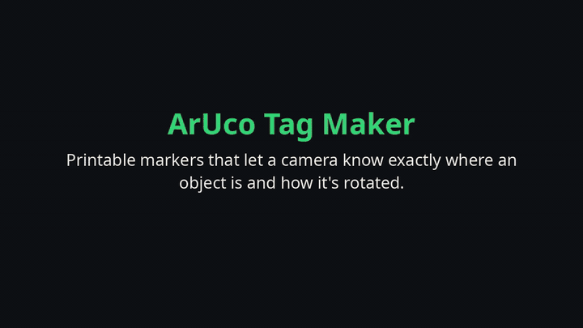
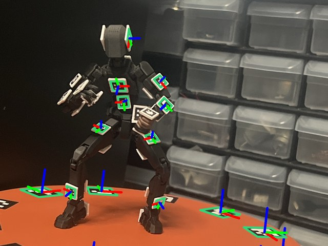
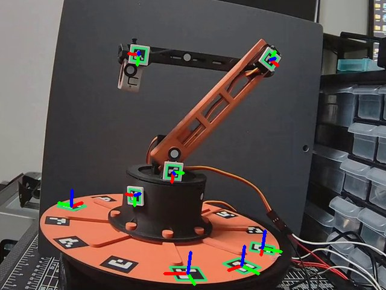
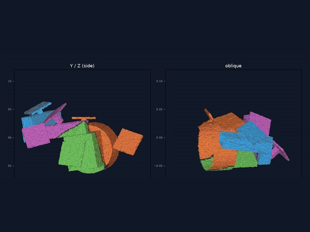
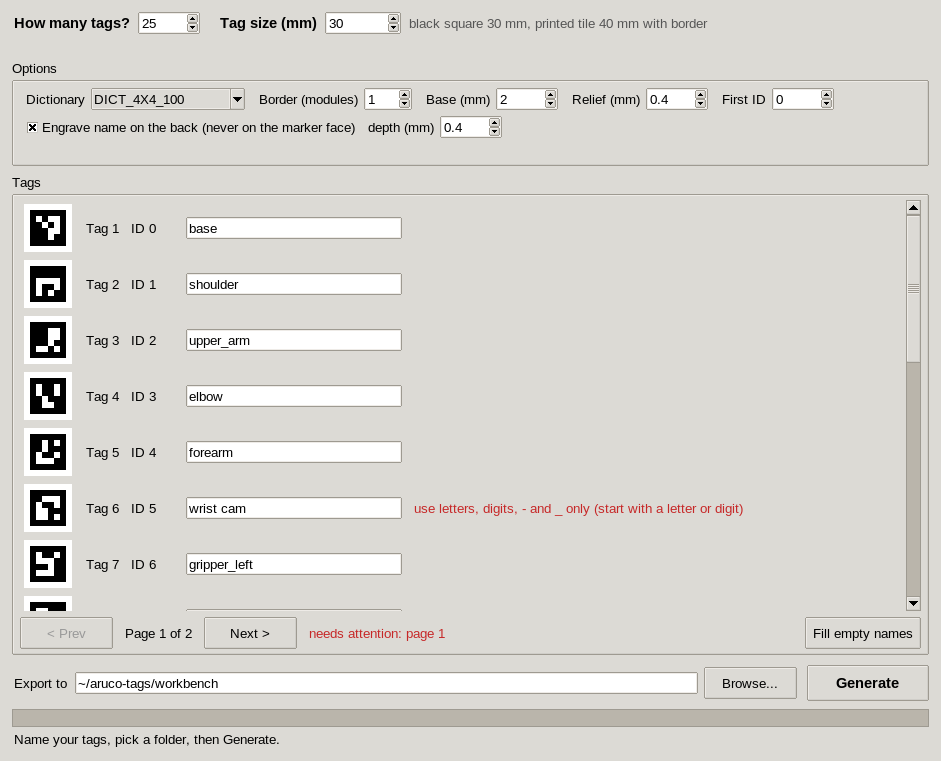

# ArUco Tag Maker

**Printable markers that let a camera know exactly where an object is and how it's rotated.**

[](docs/demo.mp4)

*Real run of the app, the STL it made, and printed tags being tracked. [Watch the 25-second video (MP4)](docs/demo.mp4).*

- **What it is:** a free desktop app (Linux, Windows, macOS) that makes ArUco tags, the black-and-white squares that cameras and robots use as landmarks.
- **What it does:** you type how many tags you need and a name for each one ("head", "left_gripper"). It writes a 3D-printable file per tag and a lookup file your own code can import.
- **Why it matters:** stick a tag on anything and an ordinary webcam can tell where that thing is and which way it faces. That is how a hand-posed figure becomes a digital animation, or how a robot's joints get measured without guesswork.

## Where the tags are used

| [PoseBridge](https://github.com/tardigraderesearch/posebridge) | [robo_prober](https://github.com/tardigraderesearch/robo_prober) | [Digital Twin Generator](https://github.com/tardigraderesearch/digital-twin-generator) |
|---|---|---|
| [](https://github.com/tardigraderesearch/posebridge) | [](https://github.com/tardigraderesearch/robo_prober) | [](https://github.com/tardigraderesearch/digital-twin-generator) |
| **Pose a figure, get an animation.** Tags on a 3D-printed figure let PoseBridge rebuild its pose on a Blender rig and export it to Unreal Engine. | **Map an unknown robot.** A camera watches the tags while each servo is nudged, recording which joint moved. It reads this app's `markers.json` directly. | **Build a simulation model of a real robot.** Tags tie the camera's view of each moving joint to a 3D scan, so the scan can be cut into parts and turned into a URDF. |

Coloured axes in the first two pictures are real detections: OpenCV found each printed tag and its 3D orientation.

Every export is checked before it is reported as done: each tag image and a
top-down render of each STL must decode to the right id, and every mesh must be a
closed, printable solid.

## Quickstart

Download or clone this repository, then:

```bash
cd aruco_tag_maker
python aruco_tag_maker.py
```

(`python3` on systems without a `python` command.) It is one standard-library-only
file, so the steps are the same on every system:

1. checks for Python 3.11 or newer (and tells you exactly what to install if there is none),
2. checks that Tk (the window toolkit) is available, with the fix for your system if not,
3. asks before installing: "Install now? [Y/n]" (`-y` or a non-interactive run says yes),
4. creates a private `.venv` next to the file and installs the app and its libraries
   into it, only when they changed since the last run,
5. says "All dependencies present. Good to go." and opens the window.

The first launch needs internet and takes a minute or two; after that it starts
straight away. Nothing is installed system-wide and it never asks for admin rights.
To start over, delete the `.venv` folder.

If Tk is missing it prints the fix, for example:

| System | Command |
| --- | --- |
| Debian / Ubuntu | `sudo apt install python3-tk` |
| Fedora | `sudo dnf install python3-tkinter` |
| Arch | `sudo pacman -S tk` |
| openSUSE | `sudo zypper install python3-tk` |
| Alpine | `sudo apk add py3-tkinter` |
| macOS | Python from [python.org](https://www.python.org/downloads/macos/) (includes Tk) or `brew install python-tk` |
| Windows | Python from [python.org](https://www.python.org/downloads/windows/) with "tcl/tk and IDLE" ticked |

### Alternative: pipx

```bash
pipx install git+https://github.com/tardigraderesearch/aruco-tag-maker
aruco-tag-maker            # opens the window
```

`pip install .` inside a virtual environment works the same way.

## Using the app



1. **How many tags?** 1 to 99.
2. **Tag size (mm):** the side of the black square, 5 to 300 mm (default 30). The
   printed tile is a little bigger because it includes the white border; the app
   shows both numbers.
3. **Name each tag.** Tags are listed 20 per page, each with its marker preview and
   id. Names may use letters, digits, `-` and `_` (up to 32 characters, starting
   with a letter or digit), must be unique ignoring case, and cannot be reserved
   Windows names such as `CON` or `NUL`. Problems show up in red next to the field;
   the page bar tells you which pages still need attention. **Fill empty names**
   gives any blank ones `tag_01`, `tag_02`, ...
4. **Options** (sensible defaults, change only if you need to):
   - *Dictionary:* `DICT_4X4_100` by default. Only dictionaries with at least 100
     ids are offered (4x4, 5x5, 6x6, 7x7 in 100/250/1000 sizes, and the original
     ArUco set), so every count fits.
   - *Border:* white quiet zone around the marker, in marker modules (1 to 4).
   - *Base / Relief:* thickness of the white base and height of the raised black
     pattern.
   - *First ID:* tag 1 gets this id, tag 2 the next one, and so on.
   - *Engrave name on the back:* cuts the name, mirrored, into the underside so it
     reads correctly when you turn the tile over. The marker face is never touched,
     so detection is not affected. Names that would be too small to print at the
     chosen size are flagged before export.
5. **Export to:** type a folder or pick one with **Browse...**, then **Generate**.
   It is created if needed; if files would be overwritten you are asked first.
   When it finishes, **Open folder** shows the result.

## Scripting (no window)

```bash
aruco-tag-maker generate --names examples/names.txt --out my-tags
aruco-tag-maker generate --names names.txt --out my-tags --tag-size 50 \
    --dictionary DICT_5X5_100 --start-id 20 --no-engrave --overwrite
aruco-tag-maker verify my-tags     # re-check an export at any time
aruco-tag-maker doctor             # check Python, libraries and Tk
```

`names.txt` has one name per line; blank lines and `#` comments are ignored. The
same commands work through the one file, e.g. `python aruco_tag_maker.py generate --names ...`,
and they do not need Tk.

## Output

```
my-tags/
  markers.json
  markers.py
  png/<name>.png                         marker image with white border (for paper or checking)
  stl/<name>.stl                         one body; single extruder with a filament swap
  stl/multi-material/<name>_white.stl    base (plus engraved name)
  stl/multi-material/<name>_black.stl    raised marker pattern
```

`markers.json`:

```json
{
  "generator": "aruco-tag-maker 0.1.0",
  "dictionary": "DICT_4X4_100",
  "tag_size_mm": 30.0,
  "tile_size_mm": 40.0,
  "quiet_zone_modules": 1,
  "tags": {
    "base": {"id": 0},
    "shoulder": {"id": 1},
    "gripper_left": {"id": 2}
  },
  "print": {"base_thickness_mm": 2.0, "relief_mm": 0.4, "filament_swap_z_mm": 2.0, "...": "..."},
  "settings": {"...": "every setting used, so the set can be regenerated"}
}
```

`tag_size_mm` is the black square, which is the `markerLength` OpenCV wants for
pose estimation. `tile_size_mm` is the whole printed tile.

## Using the markers from another program

**Python, `markers.py`:** copy it next to your code and import it. The lookup
tables need nothing; `detect()` needs OpenCV (`pip install opencv-python`) and is
only imported when you call it.

```python
import cv2
import markers

markers.MARKERS["gripper_left"]   # -> 2
markers.ID_TO_NAME[2]             # -> "gripper_left"
markers.DICTIONARY                # -> "DICT_4X4_100"
markers.TAG_SIZE_MM               # -> 30.0

frame = cv2.imread("photo.jpg")
markers.detect(frame)                      # -> ["gripper_left", "base"]
markers.detect(frame, with_corners=True)   # -> [("gripper_left", 4x2 corners), ...]
```

Ids in the frame that are not part of this set are ignored.

**Anything else, `markers.json`:**

```python
import json
data = json.load(open("my-tags/markers.json"))
name_to_id = {name: tag["id"] for name, tag in data["tags"].items()}
```

```javascript
const data = JSON.parse(fs.readFileSync("my-tags/markers.json", "utf8"));
const idToName = Object.fromEntries(Object.entries(data.tags).map(([n, t]) => [t.id, n]));
```

[`examples/use_markers.py`](examples/use_markers.py) shows both.

## Printing tips

- **Single extruder:** print `stl/<name>.stl` in matte white, pause at the
  filament swap height (`filament_swap_z_mm`, default 2.0 mm, i.e. the top of the
  base), switch to matte black and let it finish the raised pattern. Most slicers
  can insert the pause for you ("pause at height" / "color change").
- **Multi-material (AMS, MMU, IDEX):** load both files from `stl/multi-material/`
  together as one object with two parts, white for `_white`, black for `_black`.
- **Matte filament** helps a lot: glossy black reflects light and can look white
  to a camera at some angles.
- **Thickness:** the 2.0 mm base keeps small tiles flat; 0.4 mm of relief is two
  0.2 mm layers of black, enough to be opaque. Thicker relief makes stronger
  shadows at shallow viewing angles, so keep it thin.
- **Size:** detection range grows with tag size. With a 0.4 mm nozzle, keep
  4x4 tags at 12 mm or more and use bigger tags for denser dictionaries (each
  module should be at least about 2 mm).
- **Engraving** is on the face that sits on the bed and usually bridges cleanly; turn it
  off for very small tiles or if your printer struggles with the first layer.

## Development

```bash
python -m venv .venv && . .venv/bin/activate     # Windows: .venv\Scripts\activate
pip install -e ".[test]"
pytest                    # the GUI smoke test needs a display; on Linux: xvfb-run -a pytest
```

Layout: `settings.py` (limits, validation, pagination), `marker.py` (bit patterns
and images), `mesh.py` (STL geometry via [manifold3d](https://github.com/elalish/manifold)),
`exporter.py`, `verify.py`, `gui.py` (tkinter only, no logic of its own), `cli.py`.
CI runs the tests on Linux, Windows and macOS with Python 3.11 and 3.12, and runs
`python aruco_tag_maker.py` from a fresh checkout on each platform.

## License

MIT, see [LICENSE](LICENSE).
